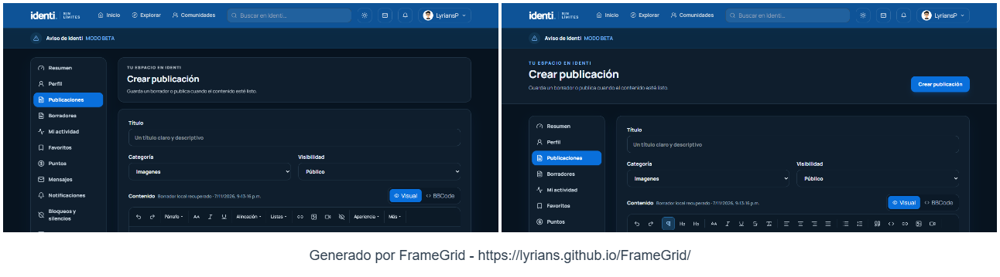
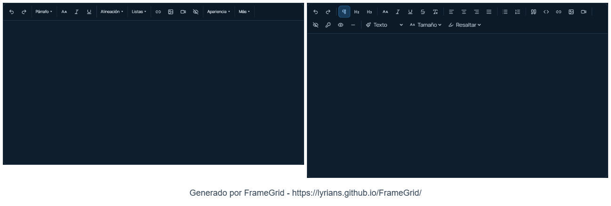
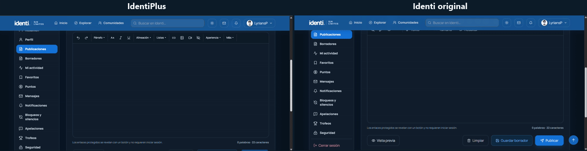
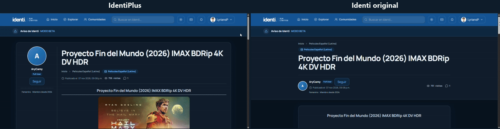

# Identi+ (Extensión para navegadores)
Identi+ es una extensión para mejorar la experiencia en Identi con diseños más cómodos, herramientas para el editor y correcciones de interfaz que cada usuario puede activar o desactivar.

# Cambios
- Editor de posts: El editor de posts tenía varios errores visuales y de experiencia.
- Explorar: La pagina "explorar" tenia elementos invasivos, repetitivos, innecesarios. Se compactaron, y corrigieron errores.
- Publicaciones: Se corrigió el diseño de los posts, se le dio importancia a la publicación, y se ordeno la distribución de este mismo.

# Cambio visual
### Crear nueva publicación
Se cambio el diseño de la vista de crear publicación, ya que los elementos ocupaban demasiado protagonismo, y se eliminaron botones invasivos como "Crear publicación". Innecesario sabiendo en donde ya estamos parados. (Izquierda Identi+, derecha original).

### Barra de editor de posts
- Se compactó la barra del editor de post para que sea mas prolija
- Se corrigió el error de la misma barra, ya que al hacer scroll se ocultaba con el menú.
- Se eliminó el botón de limpiar formulario de creación de post, ya que fue agregado oficialmente.

### Publicaciones
- Se corrigió por completo el diseño de los posts para una mayor comodidad de lectura, dando importancia al contenido del post, y comentarios.

