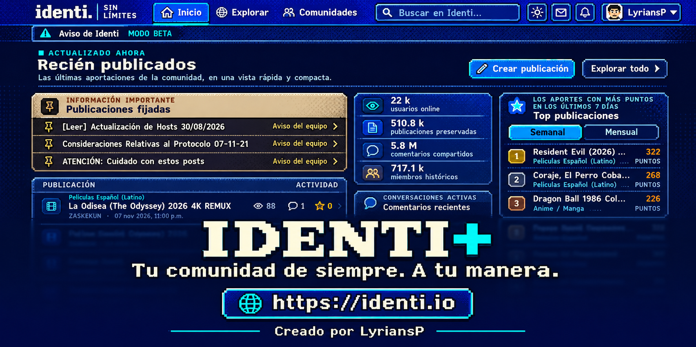
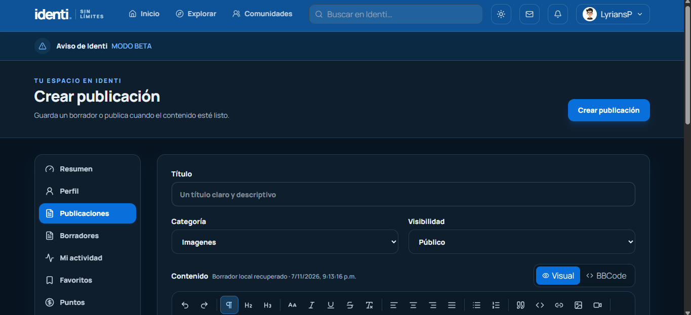

# Identi+ (Extensión para navegadores)
Identi+ es una extensión para mejorar la experiencia en Identi con diseños más cómodos, herramientas para el editor y correcciones de interfaz que cada usuario puede activar o desactivar.

# Cambios
Editor de posts: El editor de posts tenía varios errores visuales y de experiencia.
Explorar: La pagina "explorar" tenia elementos invasivos, repetitivos, innecesarios. Se compactaron, y corrigieron errores.
Publicaciones: Se corrigió el diseño de los posts, se le dio importancia a la publicación, y se ordeno la distribución de este mismo.

## Cambio visual
### Crear nueva publicación
Se cambio el diseño de la vista de crear publicación, ya que los elementos ocupaban demasiado protagonismo, y se eliminaron botones invasivos como "Crear publicación". Innecesario sabiendo en donde ya estamos parados.

